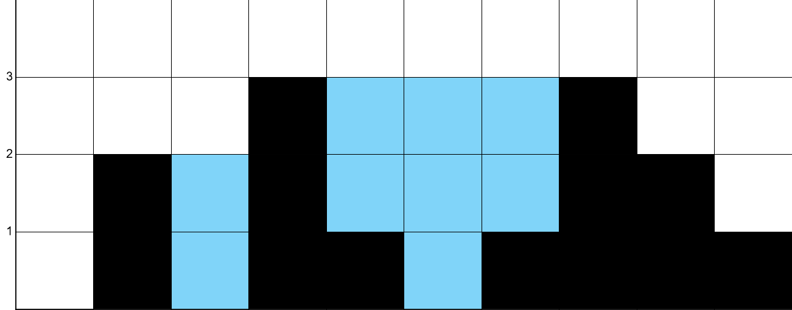
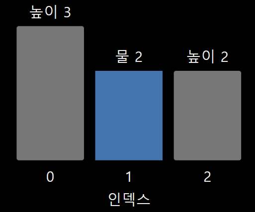
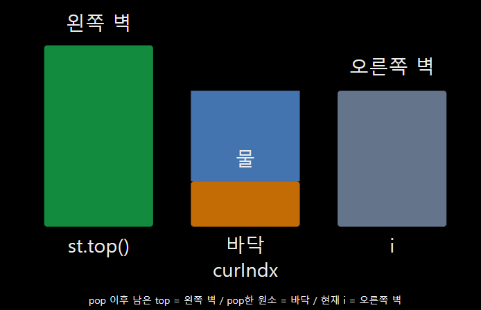
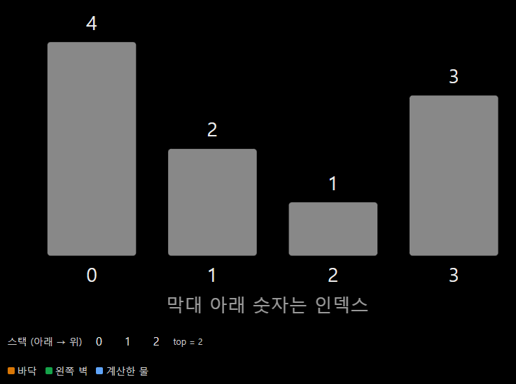
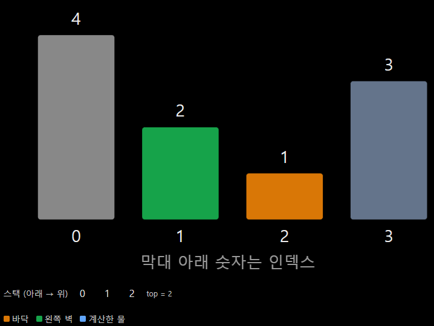
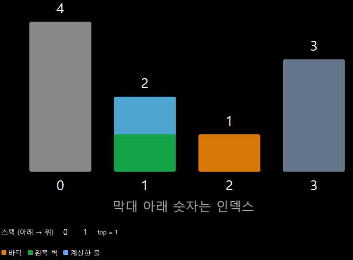
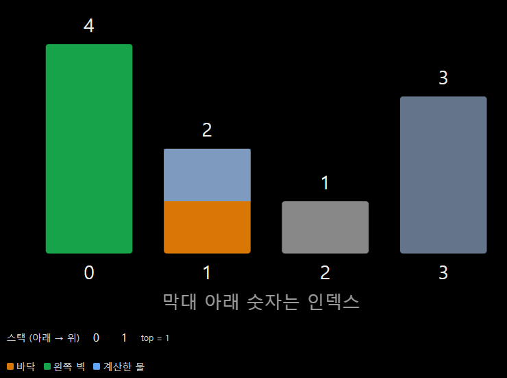
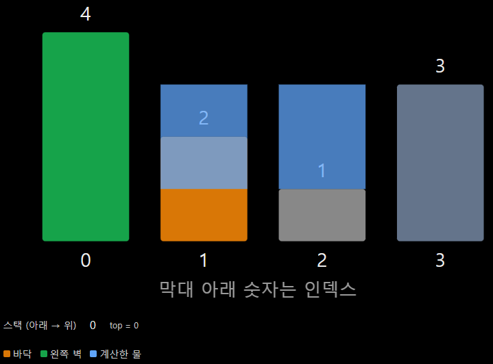
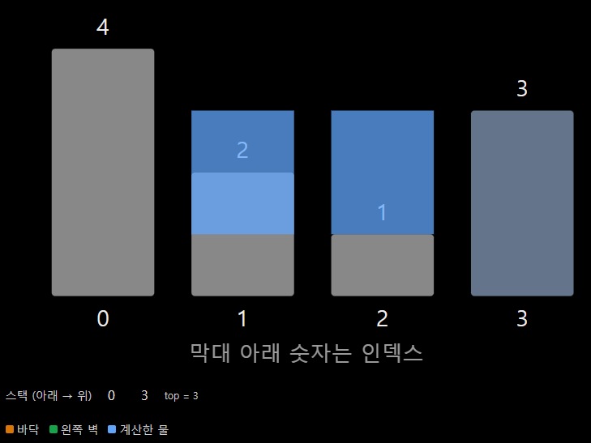

# LeetCode 42. Trapping Rain Water

[원문](https://keyone957.tistory.com/55) · 2026. 10. 20. 16:07

[Trapping Rain Water - LeetCode](https://leetcode.com/problems/trapping-rain-water/description/)

## 문제 설명



n개의 음이 아닌 정수가 주어지는데 각 막대의 너비는 1입니다. 비가 내린 후 얼마나 많은 물을 가둘 수 있는지 계산하는 문제

```cpp
Input: height = [0,2,0,3,1,0,1,3,2,1]

Output: 9
```

## 문제 풀이 => 투포인터, 단조 스택

### 0. 문제의 핵심 : 물이 고이기 위해?

물이 고이려면 왼쪽 벽, 오른쪽 벽이 필요함.

예를 들어 height = {3, 0, 2};이 있다면



물이 고이기 위해서는 위사진과 같이 오른쪽에 자신보다 높은 벽이 나타나야 함 위 물의 양을 식으로 나타내면

> 물의 양 = min(왼쪽 벽, 오른쪽 벽) - 현재 인덱스의 높이 * 너비

가 된다.

즉 물이 고이려면 오른쪽에 바닥보다 높은 벽이 나타나야 한다는 것임.

### 1. 투포인터를 이용한 문제 풀이 방식

이 문제는 이전에 한번 풀었던 문제이다. 그때는 투포인터를 활용해서 문제를 풀었었다.

1. 배열의 양 끝에 두개의 포인터를 배치하고 양쪽에서 발견한 최대 높이를 각각 관리한다.

2. 양쪽 막대의 높이를 비교하여 더 낮은 쪽의 포인터를 기준으로 물의 양을 계산한다.

3. 현재 막대가 해당 방향의 최대 높이보다 낮으면 그 차이만큼 물이 고이므로 정답에 더하고 더 높으면 최대 높이를 갱신한다.

핵심 : **각 칸 i에 고이는 물의 양은 " min(왼쪽 최대 높이, 오른쪽 최대 높이) - 그 칸의 높이 " 로 구할 수 있다.**

```cpp
class Solution {
public:
    int trap(vector<int>& height) {
        int answer=0;
        int arrSize=height.size();
        int left=0;
        int right=arrSize-1;
        int leftMax=height[left];
        int rightMax=height[right];
        while(left<right)
        {
            if(height[left]<height[right])
            //왼쪽 벽이 더 낮으면 왼쪽을 처리
            {
                if(leftMax>height[left])
                {
                    answer+=leftMax-height[left];
                    //현재 칸보다 높은 왼쪽 벽이 있으면 그 차이만큼 물이 고임
                }
                else
                {
                    leftMax=height[left];
                    //물이 안 고이면 왼쪽 최대값 갱신
                }
                left++;
                //왼쪽 포인터 안쪽으로 이동시킴
                
            }
            else
            //오른쪽 벽이 더 낮거나 같으면 오른쪽 처리
            {
                if(rightMax>height[right])
                {
                    answer+=rightMax-height[right];
                }
                else
                {
                    rightMax=height[right];
                }
                right--;
            }
        }
        return answer;
    }
};
```

### 2. 단조 스택을 이용한 문제 풀이

투 포인터는 각 칸에 고이는 물의 양을 계산하는 방식이지만

단조 스택은 물이 고일 수 있는 **오른쪽벽을 발견했을 때** 두 벽 사이에 고이는 물의 양을 계산하는 방식으로 풀 수 있다.

**단조 감소 스택**을이용해 스택에는 인덱스를 저장한다.  
물이 고이려면 왼쪽 벽, 바닥, 오른쪽 벽이 필요함

왼쪽에서 오른쪽으로 막대를 탐색할 때 높이가 계속 낮아진다면 아직 물을 가둘 오른쪽 벽을 발견하지 못한 상태임

따라서 막대의 인덱스를 단조 감소 스택에 저장하다가 현재 막대가 스택의 top보다 높아지는 순간 물이 고일 수 있는 구간을 계산할 수 있으므로 계산이 가능하다.

풀이 과정

1. 스택에 막대의 인덱스를 저장하면서 왼쪽에서 오른쪽으로 탐색

2. 현재 막대가 스택의 top보다 높으면 물이 고일 수 있는 구간임

3. 이때 **pop한 원소는 바닥 (물이 고일 칸)**, **pop 이후의 top은 왼쪽 벽**, **현재 탐색 중인 인덱스는 오른쪽 벽**이 됨

4. 두 벽 중 낮은 높이에서 바닥 높이를 빼 물의 높이를 계산하고 두 벽 사이의 너비를 곱하여 정답에 더함

5. 위 과정을 반복하며 전체 물의 양을 계산한다.

=> 단조 감소 스택을 유지하다가 현재 막대가 스택의 top 보다 높아지는 순간 그곳이 물이 고이는 구간이므로 물의 양을 계산한다.



```cpp
int curIndx=st.top(); => pop한 원소의 인덱스 -> 즉 물이 고일 칸
st.pop();

if(st.empty()) break;

int curH=min(height[st.top()],height[i])-height[curIndx]; 
//pop이후의 st.top은 왼쪽벽
//i => 현재 탐색 중인 인덱스 -> 오른쪽 벽
int water=curH*(i-st.top()-1);

answer+=water;
```

그림으로 알아보는 코드 실행 순서 (좌 -> 우 순서 사진)

| 왼쪽 | 오른쪽 |
| --- | --- |
|  |  |
| 1. 높이 4 2 1 순서로 감소하므로 인덱스 0 1 2가 스택에 있음 | 2. 높이 3인 막대가 나타남 현재 높이 3이 현재 top의 높이 1보다 크므로 인덱스 2를 물이 고일 위치로 선택함 |
|  |  |
| 3. 인덱스 2를 pop하고 남은 top은 인덱스 1 (왼쪽 벽), 현재 i=3은 오른쪽 벽임 식을 이용해서 (min(2,3)-1) * 1 = 1 | 4. 현재 높이 3이 새로운 top의 높이 2보다 여전히 큼. 이번에는 인덱스 1을 바닥으로 선택함 |
|  |  |
| 5. 인덱스 1을 pop하면 왼쪽 벽은 인덱스 0 (min(4,3)-2)*2 =2를 더해서 총 물의 양은 3 | 6. 탐색 종료. |

```cpp
class Solution {
public:
    int trap(vector<int>& height) {
        int aSize=height.size();
        stack<int> st;
        // 인덱스 자체를 저장, 단조 감소 스택
        st.push(0);
        int answer=0;

        for(int i=1;i<aSize;i++)
        {
            while(!st.empty())
            {
                if(height[st.top()]<height[i])
                {
                    int curIndx=st.top();
                    //현재 top은 물이 고이는 구간의 바닥을 가리킴
                    //바닥의 인덱스를 저장

                    st.pop();
                    //바닥 제거

                    if(st.empty()) break;
                    //스택이 비어있으면 왼쪽 벽이 없는 상태이므로 물이 고일수가 없음
                    
                    //pop이후의 스택의 맨위는 왼쪽 벽의 인덱스
                    //i는 현재 탐색 중인 오른쪽 벽

                    int curH=min(height[st.top()],height[i])-height[curIndx];
                    //물의 높이
                    //두 벽중 더 낮은 높이에서 바닥 높이를 뺌

                    int water=curH*(i-st.top()-1);
                    //물의 너비 -> 오른쪽 벽과 왼쪽 벽 사이의 칸 수
                    
                    answer+=water;
                }
                else break;
                //현재 막대가 top보다 높지 않으면 단조 감소 상태가 유지되므로 종료
            }
            st.push(i);
        }

        return answer;
    }
};
```

글 내용 중에 틀린 것이 있거나 궁금한 것이 있다면 댓글 남겨주세요! 봐주셔서 감사합니다!
