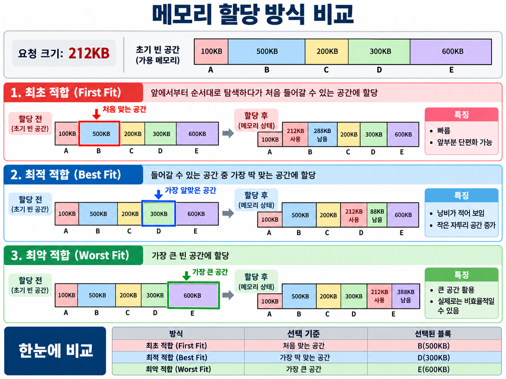

# 10/22

## 잔디 심기

[Valid Anagram - LeetCode](https://leetcode.com/problems/valid-anagram/submissions/2178566428/)

## 크래프톤 자소서 작성

## 면접 스터디 정리

### 메모리 배치 기법 → (메모리에 적합한 빈 공간을 어케 찾냐?!?!?)

---

#### 최초 적합

> 앞에서 부터 순서대로 보다가 처음 들어갈 수 있는 공간에 넣는 방식

- 처음 맞는 곳에서 멈추므로 탐색이 가장 빠름
- 앞쪽에 작은 조각들이 쌓이는 경향이 있음

#### 최적 적합

> 들어갈 수 있는 빈 공간 중에서 가장 딱 맞는 공간을 선택하는 방식

- 낭비가 가장 적어 보이지만 전체를 다 확인해야 해서 속도가 느림
- 남는 조각이 너무 작아 쓸 수 없는 작은 조각들이 많이 생김

#### 최악 적합

> 가장 큰 빈 공간에 할당하는 방식

- 큰 블록을 쪼개면 남는 공간도 커서 다음 요청에 재활용하기 쉬울 것이라는 발상
- 큰 공간을 계속 잘라 쓰므로 실제로는 비효율적일 수 있음

---

### 빈 메모리 블록 관리 방법

#### 메모리 할당자

> 프로그램의 메모리 할당 및 해제 요청을 처리하고 사용 가능한 메모리 공간을 관리

- 필요한 크기의 메모리 할당
- 사용이 끝난 메모리 공간 해제
- 사용 가능한 빈 메모리 블록 관리

---

#### Free List

> 사용가능한 빈 메모리 블록들을 연결리스트로 이어서 관리

- 각 빈 블록의 **시작 주소**, **크기**, **다음 블록의 주소** 등을 관리한다.
- 메모리 해제 시 해당 블록을 리스트에 등록하고, 필요하면 인접한 빈 블록을 병합한다.
- **장점**: 구조가 단순하고 다양한 크기의 블록을 관리할 수 있다.
- **단점**: 적절한 블록을 찾기 위해 리스트를 순회해야 할 수 있어 **탐색 비용**이 발생한다.

#### Bitmap

> 메모리를 일정한 크기의 단위로 나누고, 각 단위의 사용 여부를 비트로 관리하는 방식

- 각 비트는 메모리 단위의 상태를 나타낸다.
  - `0`: 빈 공간
  - `1`: 사용 중
- 메모리 할당 시 필요한 만큼 연속된 빈 비트를 탐색한다.
- **장점**: 적은 메모리로 많은 블록의 사용 상태를 관리할 수 있다.
- **단점**: 연속된 빈 공간을 찾기 위한 탐색 비용이 발생할 수 있다.
  - 단위 크기가 작을수록 비트맵이 커지고 크면 내부 단편화가 늘어남

#### Tree

> 빈 메모리 블록을 크기 또는 주소를 기준으로 정렬하여 트리 구조로 관리하는 방식

- 각 노드는 빈 메모리 블록의 주소와 크기 등을 관리한다.
- 메모리 할당 시 트리를 탐색하여 적절한 크기의 블록을 선택한다.
- 메모리 해제 시 블록을 트리에 등록하고 필요하면 인접 블록을 병합한다.
- **장점**: 균형 이진 탐색 트리를 사용하면 적절한 블록을 일반적으로 (O(log n))에 탐색할 수 있다.
- **단점**: 트리 구조를 유지하기 위한 추가 메모리와 관리 비용이 발생한다.
