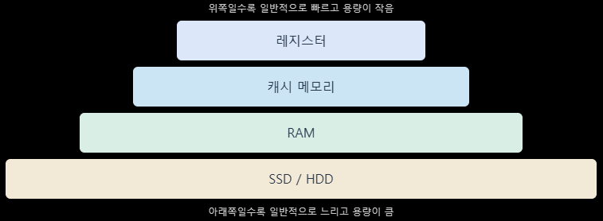

# 10/26

## 잔디 심기

[NeetCode | Coding Interview Prep, Courses, Versus Mode](https://neetcode.io/problems/subarray-product-less-than-k/history?list=neetcode150&submissionIndex=0)


```cpp
class Solution {
public:
    int numSubarrayProductLessThanK(vector<int>& nums, int k) {
        int aSize=nums.size();
        int left=0;
        int right=0;
        int curMulti=1;
        int answer=0;

        while(right<aSize)
        {
            curMulti*=nums[right];

            while(curMulti>=k && left<=right)
            //현재 구간의 곱이 k이상이면 조건을 만족하지 못함
            //따라서 k미만이 될때 까지 left를 이동시켜 구간을 나눔
            {
                curMulti/=nums[left];
                //제외된 구간을 현재 값에서 제거
                left++;
            }


            answer+=right-left+1;
            right++;
        }

        return answer;
    }
};
```

⇒ 슬라이딩 윈도우 방식

## vr 프로젝트 사운드, tts 정리

## CS 정리

### class와 struct 차이

#### class, struct

> 기본 접근 제어자와 기본 상속 방식 두 가지만 다름. 나머지 기능은 완전히 같다.

|               | class      | struct    |
| ------------- | ---------- | --------- |
| 멤버 기본 접근 제어   | private    | public    |
| 상속 시 기본 접근 방식 | private 상속 | public 상속 |

```cpp
class A { int x; };    // x는 private
struct B { int x; };   // x는 public

class C : Base {};     // private 상속
struct D : Base {};    // public 상속
```

#### C# 과의 차이점

|                 | C++               | C#               |
| --------------- | ----------------- | ---------------- |
| class vs struct | 기본 접근 제어자만 다름     | 값타입 vs 참조 타입     |
| 저장 위치           | 둘 다 선언한 방식에 따라 다름 | struct는 값타입 ⇒ 스택 |
| class는 참조타입 ⇒ 힙 |                   |                  |
| 상속              | 둘 다 가능            | struct는 상속 X     |

#### 정리

> c++에서 class와 struct는 기본 접근 제어자와 기본 상속 방식만 다르고 기능은 동일함.

---

### 메모리의 종류 → 주기억장치, 보조기억장치

#### 주기억장치

> CPU가 직접 접근하는 메모리.  실행 중인 프로그램과 데이터가 올라가는 곳

##### RAM

- 실행 중인 프로그램과 데이터를 임시로 저장함
- 일반적으로 전원이 꺼지면 데이터가 사라지는 휘발성 메모리
- CPU가 작업할 때 사용하는 주요 메모리

##### ROM

- 전원이 꺼져도 데이터가 유지되는 비휘발성 메모리
- 펌웨어나 부팅 관련 코드 등을 저장하는 데 사용

---

#### 보조기억장치

> 프로그램과 데이터를 장기간 저장하는 장치.  CPU가 직접 접근하지 못하고 필요할 때 주기억장치로 읽어 와야 함

##### SSD

- 플래시 메모리를 사용해 데이터를 저장

##### HDD

- SDD보다 일반적으로 느리지만 용량 대비 가격이 저렴

##### 특징

- 전원이 꺼져도 데이터가 유지됨 ⇒ 비휘발성
- RAM보다 일반적으로 접근 속도가 느림
- 장기적인 데이터 저장에 적합

---

### 휘발성 vs 비휘발성 메모리

#### 휘발성 메모리

> 전원이 꺼지면 저장된 데이터가 사라지는 메모리

- RAM
- 데이터 읽기, 쓰기 속도가 빠름
- 실행 중인 프로그램과 데이터를 임시로 저장하는 데 사용됨

#### 비휘발성 메모리

> 전원이 꺼져도 저장된 데이터가 유지되는 메모리

- ROM, SSD, HDD
- 프로그램, 운영체제, 파일 등을 장기간 저장하는 데 사용됨
- 일반적으로 RAM보다 데이터 접근 속도가 느림

---

### 레지스터

#### 레지스터

> `CPU 내부에 존재`하는 매우 빠르고 작은 기억 장치.  
> CPU가 연산을 수행할 때 필요한 데이터나 주소 등을 임시로 저장하는 공간

#### 필요 이유

> CPU는 연산 속도가 매우 빠른데 RAM은 그에 비해 한참 느림. CPU가 계산할 때마다 RAM까지 갔다오면 대부분의 시간을 기다리는 데 쓰게됨. 따라서 지금 계산에 쓰는 값만 CPU안쪽 레지스터에 가져다 놓고 사용함.

EX)

```cpp
int a=10; int b=10; int c= a + b;
1. RAM에 있는 a를 레지스터 1로 가져옴
2. RAM에 있는 b를 레지스터 2로 가져옴
3. 레지스터 1 + 레지스터 2 = 30 계산 -> 결과는 레지스터에 들어감
4. 결과 30을 RAM의 c에 저장.
```

- 휘발성
- 용량 : 매우 작음
- CPU는 메모리의 값을 레지스터로 가져온 뒤 연산하고 결과를 다시 메모리에 씀
- RAM이나 캐시 메모리보다 일반적으로 빠름.

```cpp
레지스터 > L1 > L2 > L3 캐시 > RAM > SSD/HDD
(가장 빠르고 작음)                   (느리고 큼)
```

#### 주요 레지스터

|                       | 담는 것               | 역할                     |
| --------------------- | ------------------ | ---------------------- |
| 프로그램 카운터 (PC)         | 다음에 실행할 명령어의 주소    | 명령어 실행 순서 추적           |
| 명령어 레지스터 (IR)         | 지금 실행 중인 명령어       | 명령어 해석과 실행             |
| 스택 포인터 (SP)           | 스택 최상단 주소          | 함수 호출 시 스택 할당/해제       |
| 베이스 포인터 (BP/FP)       | 현재 스택 프레임의 시작 주소   | 지역 변수와 매개변수 접근         |
| 상태 레지스터 (플래그)         | 직전 연산의 결과 상태       | 0,음수,오버플로우 인지          |
| 메모리 주소 레지스터 (MAR)     | 접근할 메모리 주소         | 메모리 읽/쓰 대상 지정          |
| 메모리 버퍼 레지스터 (MBR/MDR) | 메모리에서 읽어 오거나 쓸 데이터 | 메모리와 CPU 사이의 데이터 임시 보관 |

#### 명령어 하나가 처리될 때 흐름

```cpp
1. PC가 가리키는 주소를 MAR에 넣음
2. 메모리에서 명령어를 읽어 MBR로 가져옴
3. MBR의 명령어를 IR로 옮기고, PC를 다음 주소로 증가
4. IR의 명령어를 해석해서 범용 레지스터로 연산 수행
5. 결과에 따라 상태 레지스터의 플래그가 바뀜
```



---

### 캐시 매핑 기법

> 주기억장치(RAM)의 데이터를 캐시 메모리의 어느 위치에 저장할 지 결정하는 방식

#### 직접 매핑

> 각 RAM 블록이 들어갈 수 있는 캐시 라인이 딱 1곳으로 정해져 있음

캐시 라인 = 블록 번호 MOD 캐시 라인 수 → 모듈러 연산 사용

- 장점
  
  - 구조가 단순, 탐색이 빠름

- 단점
  
  - 충돌 미스
    ⇒캐시의 0번, 2~9번 칸이 전부 텅 비어 있어도, 프로그램이 하필 1번과 11번 데이터를 번갈아 읽으면 1번 칸 하나만 두고 서로 계속 밀어내고 덮어쓰는 현상(캐시 스래싱, Cache Thrashing)이 발생해 성능이 급락합니다.

#### 완전 연관 매핑

> 메인 메모리의 데이터가 캐시의 비어있는 아무 자리에나 들어갈 수 있는 방식

인덱스 개념이 없음. 그냥 단순히 빈자리가 있으면 넣음

- 장점
  - 빈 라인이 있으면 항상 쓸 수 있어 Conflict Miss가 없음
- 단점
  - 지정석이 없다보니 CPU가 데이터를 찾을 때 캐시의 첫 번째 칸부터 끝까지 모든 태그를 동시에 다 뒤져서 비교해야함. ⇒ LRU와 같은 교체 정책이 필요함

#### 세트 연관 매핑

> 캐시를 여러 세트로 묶고 각 메모리 블록을 지정된 집합 안의 어느 라인에나 저장할 수 있는 방식. ⇒ 현대 CPU가 사용하는 방식

EX)

```cpp
세트 번호 = 블록 번호 % 세트 수
13 % 4 = 1  → 13번 블록은 1번 세트의 2개 라인 중 빈 곳
1번 세트에는 1, 5, 9, 13, 17... 블록이 들어올 수 있고,
같은 세트 안에서는 2개까지 공존함
```

⇒ 정해진 집합 안에서 자유롭게 매핑

- 장점
  - 직접 매핑보다 충돌이 적고 완전 연관보다 비교횟수가 적음
- 단점
  - 세트가 가득 차면 교체 정책이 필요
  - 직접 매핑보다 구조가 복잡함
