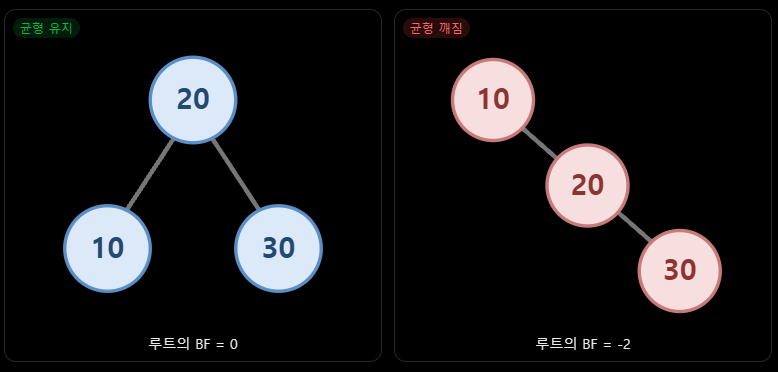
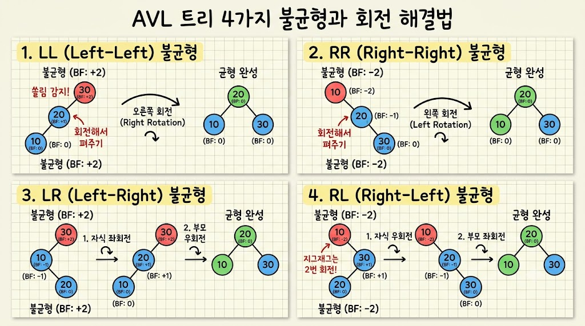

# 10/27

## 잔디 심기

[Subarray Product Less Than K - NeetCode](https://neetcode.io/problems/subarray-product-less-than-k/question)

#### 오답 풀이 ⇒ 누적 곱 + 이분 탐색 —> 오버플로우 발생.

문제 풀이 방법

1. 누적 곱 배열을 먼저 만듦
2. left 인덱스를 고정 시켜놓고 곱이 k미만인 가장 먼 right 인덱스를 탐색
3. mid를 기준으로 prefix[mid+1] / prefix[left]; 이 구간의 곱을 구함
4. 구간 곱이 k미만이면 right를 mid를 갱신하고 low = mid +1 로 이동하여 더 먼 인덱스를 탐색
5. 구간 곱이 k 이상이면 high = mid -1 로 이동해 탐색 범위 줄임

⇒ 크아악 근데 누적 곱을 계산하는 과정에서 long long 의 범위를 초과하여 오버 플로우 발생

```cpp
class Solution {
public:
    int numSubarrayProductLessThanK(vector<int>& nums, int k) {
        int aSize=nums.size();
        int answer=0;
        int left=0;
        //부분 배열 시작 인덱스

        if(k<=1)
        {
            return 0;
        }

        // 누적 곱 계산
        vector<long long> prefix(aSize+1,1);

        for(int i=0;i<aSize;i++)
        {
            prefix[i+1]=prefix[i]*nums[i];
        }

        while(left<aSize)
        {
            int low=left;
            int high=aSize-1;
            int right=left-1;

            // 현재 left에서 조건을 만족하는
            // 가장 먼 right를 이분 탐색
            while(low<=high)
            {
                int mid=low+(high-low)/2;

                // nums[left]부터 nums[mid]까지의 곱
                long long curMulti=prefix[mid+1]/prefix[left];

                if(curMulti<k)
                {
                    right=mid;
                    low=mid+1;
                }
                else
                {
                    high=mid-1;
                }
            }

            // 현재 left에서 시작하는 부분 배열의 개수
            answer+=right-left+1;
            left++;
        }

        return answer;
    }
};
```

#### 해결 방법 ⇒ 로그의 성질을 이용하여 누적 로그 사용 +이분 탐색

1. 문제 푸는 방식은 똑같음 그러나 누적 곱의 배열을 만드는 것이 아니라 로그의 성질을 사용해서 오버플로우를 해결

log(a x b) = log(a) + log (b) 를 이용하여 곱셈을 덧셈으로 변환

기존 누적 곱 배열 대신에 log(nums[i])를 누적하여 누적 로그 배열을 생성함

이외 나머지는 문제 풀이 방식이 같음

추가 사항

```cpp
if(curSum<target-1e-10)
```

위 부분을 넣는 이유는 부동소수점 연산 오차를 고려하기 위해 사용한 매우 작은 값임.

로그 계산에서는 double을 사용하므로 실제로 두 값이 같아도 미세한 오차가 발생할 수 있음

```cpp
class Solution {
public:
    int numSubarrayProductLessThanK(vector<int>& nums, int k) {
        int aSize=nums.size();
        int answer=0;
        int left=0;

        if(k<=1)
        {
            return 0;
        }

        // 누적 로그 배열
        vector<double> prefix(aSize+1,0);

        for(int i=0;i<aSize;i++)
        {
            /* prefix[i+1]=prefix[i]+log(nums[i]); */
        }

        double target=log(k);

        while(left<aSize)
        {
            int low=left;
            int high=aSize-1;
            int right=left-1;

            while(low<=high)
            {
                int mid=low+(high-low)/2;

                // nums[left]부터 nums[mid]까지의 곱을
                // 로그의 합으로 비교
                    /* double curSum=prefix[mid+1]-prefix[left]; */

                if(curSum<target-1e-10)
                {
                    right=mid;
                    low=mid+1;
                }
                else
                {
                    high=mid-1;
                }
            }

            answer+=right-left+1;
            left++;
        }

        return answer;
    }
};
```

## VR 프로젝트

- 으밤공 이전 사람이 하던 것 인수 인계 및 코드 확인
- 시스템 및 씬 구성

## CS 공부 ⇒ 과거 면접 스터디 질문들 쭉 보면서 회고

### 운영체제란?

#### 운영체제

> 운영체제는 컴퓨터의 **하드웨어 자원을 관리하고, 사용자와 응용 프로그램이 하드웨어를 효율적으로 사용할 수 있도록 지원하는 시스템 소프트웨어**

#### 주요 역할

- 프로세스 관리
  - 프로세스 생성,종료, cpu 스케쥴링, 동기화
- 메모리 관리
  - 프로세스에 메모리를 할당하고 서로 침범하지 못하게 보호
- 파일 시스템 관리
  - 데이터를 파일과 디렉터리로 저장하고 접근 제어
- 입출력 장치 관리
- 보호와 보안
  - 사용자 모드와 커널 모드를 분리해 시스템과 프로세스를 보호

---

### AVL 트리 ⇒ 이것도 한쪽으로 쏠린 최악의 경우 해결

#### AVL 트리

> 이진 탐색 트리의 한 종류로 삽입과 삭제가 발생해도 트리의 높이 균형을 유지하는 자가 균형 이진 탐색트리.

⇒ 일반적인 이진 탐색 트리는 데이터가 한쪽으로 치우치면 탐색 성능이 저하될 수 있는데 AVL은 이를 방지하기 위해 자동으로 균형을 맞춤

#### 특징

- 이진 탐색 트리의 한 종류 이므로 왼쪽 자식의 값은 부모보다 작고 오른쪽 자식의 값은 부모보다 큼
- 모든 노드에서 왼쪽 서브트리와 오른쪽 서브 트리의 높이 차이가 1 이하여야함
- 균형이 깨지면 회전을 통해 균형을 유지함
- 탐색, 삽이, 삭제의 시간 복잡도 ⇒ **`$O(log n)$`**

#### 균형 인수

> 왼쪽 서브트리 높이에서 오른쪽 서브 트리 높이를 뺀 값  
> AVL 트리에서는 이 값이 **-1 0 1 중** 하나여야 함



#### AVL 트리의 회전

⇒ 균형을 맞추기 위해 4가지 회전을 사용

1. LL ⇒ **왼쪽** 자식의 **왼쪽**에 노드가 추가되어 왼쪽으로 길게 뻗은 형태
2. RR ⇒ **오른쪽** 자식의 **오른쪽**에 노드가 추가되어 오른쪽으로 길게 뻗은 형태
3. LR ⇒ **왼쪽** 자식의 **오른쪽**에 노드가 추가되어 **지그재그(`<` 모양)**로 꺾인 형태
4. RL ⇒ **오른쪽** 자식의 **왼쪽**에 노드가 추가되어 **지그재그(`>` 모양)**로 꺾인 형태



---

### AVL vs 레드블랙 트리

|            | AVL 트리     | 레드블랙 트리        |
| ---------- | ---------- | -------------- |
| 균형 조건      | 높이 차이 최대 1 | 색상 규칙으로 균형 유지  |
| 균형 유지      | 더 엄격함      | 상대적으로 느슨       |
| 탐색, 삽입, 삭제 | O(log N)   | O(log N)       |
| 특징         | 탐색에 유리     | 삽입 삭제가 잦을 때 유리 |
