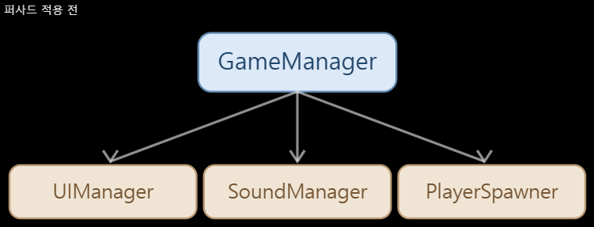
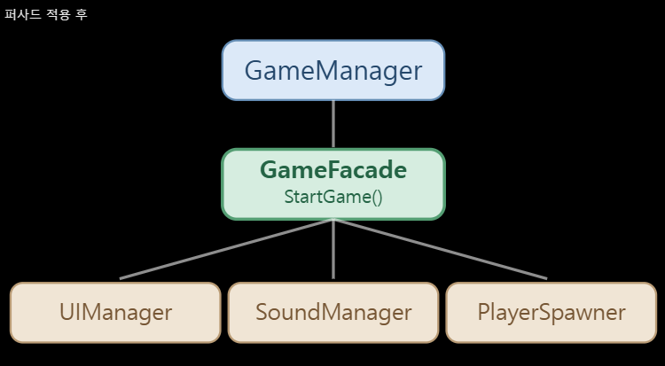
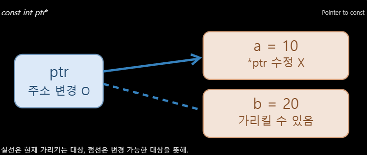
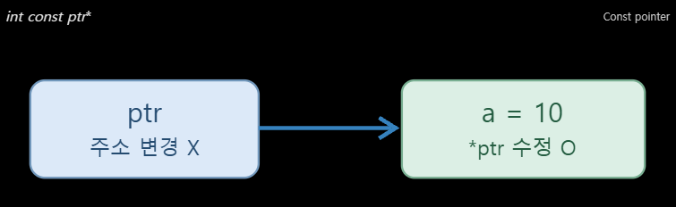
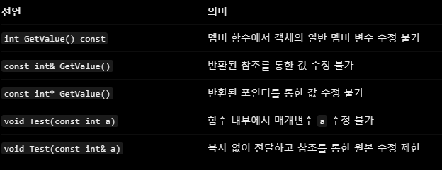

# 10/28

## 잔디 심기

[Gas Station - NeetCode](https://neetcode.io/problems/gas-station/question)

```cpp
class Solution {
public:
    int canCompleteCircuit(vector<int>& gas, vector<int>& cost) {
        int aSize=gas.size();
        int curGas=0;
        //현 출발 지점부터 누적된 가스량
        int totalNeed=0;
        //전체 주유소의 가스 수급 합계
        //한바퀴 다 완주 가능한지 확인하기 위한 합계

        int curIdx=0;
        for(int i=0;i<aSize;i++)
        {
            curGas+=gas[i]-cost[i];

            totalNeed+=gas[i]-cost[i];

            if(curGas<0)
            //현재 주유소에서 얻는 가스량 - 다음 주유소까지 필요한 가스량
            //일단 curGas 값이 만약에 음수면 가스가 부족해. 따라서 
            //현재 이 인덱스의 주유소부터는 시작을 못함
            //충전되는 가스보다 사용할 가스가 더 많다면 이제
            //출발 지점 재 설정 + 누적 가스 초기화
            {
                curGas=0;
                curIdx=i+1;
            }
        }

        if(totalNeed<0)
        //전체 가스량이 전체 이동 비용보다 부족하면
        //어느 주유소에서 출발해도 완주할 수 없다.
        {
            return -1;
        }
        return curIdx;
    }
};
```

## 자소서 작성

## 면접 스터디 대비 및 CS 공부

### 퍼사드 패턴

#### 퍼사드 패턴

> 복잡한 여러 서브시스템을 하나의 단순한 인터페이스로 묶어서 제공하는 구조적 디자인 패턴

핵심! ⇒ 복잡한 여러 시스템을 하나의 간단한 인터페이스로 감싸는 패턴

⇒ 외부에서 하위 시스템들을 각각 호출할 필요 없이 퍼사드 객체를 통해 피룡한 기능을 사용할 수 있음

#### 퍼사드 사용 이유

ex) 유니티에서 게임을 시작할 때 UI 초기화, 사운드 초기화, 플레이어 생성 이 작업이 필요하다고 치자

- 퍼사드 패턴을 사용하기 전

> 외부 코드가 각각의 시스템을 직접 호출해야함



```csharp
public class GameManager : MonoBehaviour
{
    private void Start()
    {
        UIManager.Initialize();
        SoundManager.Initialize();
        PlayerSpawner.Spawn();
    }
}
=> GameManager가 세가지 시스템에 직접 의존하고 있음
```

- 퍼사드 적용

> 여러 시스템에 대한 호출을 내부에서 처리하도록 만들 수 있음



```csharp
public class GameFacade
{
    public void StartGame()
    {
        UIManager.Initialize();
        SoundManager.Initialize();
        PlayerSpawner.Spawn();
    }
}

public class GameManager : MonoBehaviour
{
    private GameFacade _gameFacade = new GameFacade();

    private void Start()
    {
        _gameFacade.StartGame();
    }
}
=> GameManager은 개별 시스템의 초기화 순서를 알 필요 없이 
StartGame()만 호출하면된다. 
=> 퍼사드 내부의 구현이 변경되어도 외부 호출 방식은 유지할 수 있음
```

#### 장단점

| 장점                      | 단점                               |
| ----------------------- | -------------------------------- |
| 복잡한 시스템을 간단한 인터페이스로 제공  | 퍼사드 클래스에 기능이 과도하게 집중될 수 있음       |
| 외부 코드의 의존성 감소           | 퍼사드에 대한 의존성이 생김                  |
| 내부 구현 변경 시 외부 코드 수정 최소화 | 단순한 시스템에 적용하면 불필요한 구조가 될 수 있음    |
| 여러 시스템의 호출 순서를 한곳에서 관리  | 퍼사드가 모든 기능을 담당하면 유지보수가 어려워질 수 있음 |

---

### const 와 포인터

#### 상수를 가리키는 포인터 (const int* )

> 포인터를 통해 가리키는 값을 수정할 수 없지만 **포인터가 가리키는 주소는 변경할 수 있는 상태**

```cpp
int a = 10;
int b = 20;

const int* ptr = &a;

*ptr = 30; // 오류: 가리키는 값을 수정할 수 없음

ptr = &b;  // 가능: 다른 주소를 가리킬 수 있음
```



a =50 ; ⇒ 가능

ptr을 통해 수정하는 것만 제한!

`const int* ptr` 과 `int const* ptr` 은 동일

#### 상수 포인터 (int* const)

> 포인터가 가리키는 주소를 변경할 수 없지만 **가리키는 값은 수정**할 수 있는 형태

```cpp
int a = 10;
int b = 20;

int* const ptr = &a;

*ptr = 30; // 가능: a의 값 변경

ptr = &b;  // 오류: 다른 주소를 가리킬 수 없음
```



---

### const 와 함수

#### const가 함수 뒤에 붙는 경우

> 멤버 함수 내부에서 객체의 일반 멤버 변수를 변경하지 않도록 제한

- 상수 객체에서도 호출 가능
- 일반 멤버 변수 변경 불가
- 일반적으로 `const`가 아닌 멤버 함수 호출 불가
- 반환값의 종류와 관계없이 사용 가능

```cpp
class MyClass
{
private:
    int _value = 10;

public:
    int GetValue() const
    {
        // _value = 20; // 컴파일 오류
        return _value;
    }
};
```

#### const가 함수 앞에 붙는 경우

> 반환 타입에 const를 적용하여 반환된 포인터나 참조를 통한 데이터 수정을 제한할 수 있음

- 반환 타입이 포인터나 참조일 때 특히 유용함.
- `const int*`는 포인터를 통해 가리키는 값의 수정을 제한함.
- `const int&`는 반환된 참조를 통한 값 수정을 제한함.
- `const int`처럼 기본 자료형을 값으로 반환할 때는 일반적으로 의미가 없음.

```cpp
class MyClass
{
private:
    int _value = 10;

public:
    const int* GetValuePtr()
    {
        return &_value;
    }

    const int& GetValueRef()
    {
        return _value;
    }
};

MyClass obj;

const int* ptr = obj.GetValuePtr();

cout << *ptr;  // 가능: 값 읽기
// *ptr = 20;  // 오류: 값 변경 불가

const int& ref = obj.GetValueRef();

cout << ref;   // 가능
```

#### const가 매개변수에 붙는 경우

> 함수에 전달된 매개변수를 함수 내부에서 수정하지 못하도록 제한

- 값 전달에서는 매개변수 자체의 수정만 제한함.
- 참조 또는 포인터 전달에서는 원본 데이터를 해당 경로로 수정하지 못하도록 제한할 수 있음.
- `const T&`는 객체 복사를 방지하면서 데이터 수정도 제한하므로 자주 사용됨.

```cpp
void PrintValue(const int number)
{
    // number = 20; // 오류
}

void PrintVector(const vector<int>& numbers)
{
    cout << numbers.size();

    // numbers.push_back(10); // 오류
}
```

#### 정리



- 앞의 `const`: 반환된 참조로 `_value`를 수정하지 못함.
- 뒤의 `const`: 함수 내부에서 객체의 일반 멤버 변수를 수정하지 못함.
