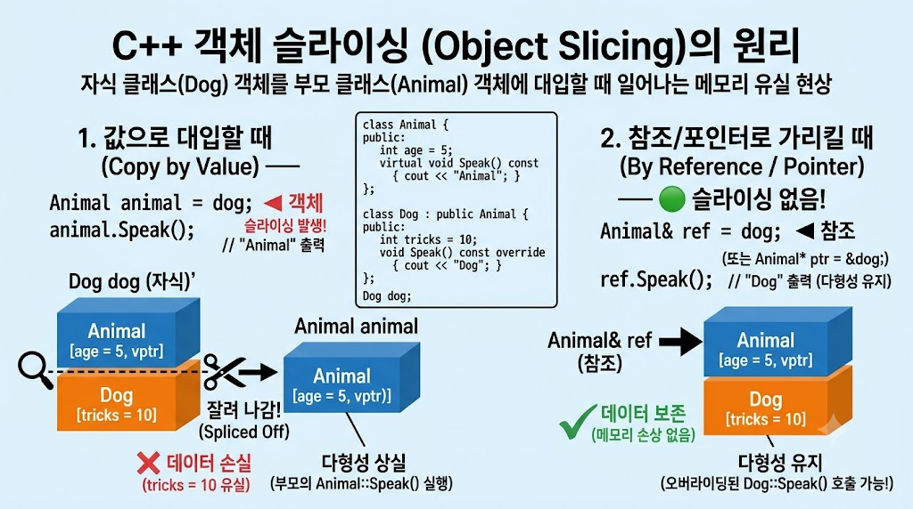

# 10/29

## 잔디 심기

[Longest Common Prefix - NeetCode](https://neetcode.io/problems/longest-common-prefix/question)

## 자소서 작성

## 면접 스터디 회고

### 매크로

#### 매크로

> 전처리기가 컴파일 전에 특정 코드나 이름을 다른 코드로 치환하는 기능

#### 매크로 상수

> #define 과 같은 전처리기 지시어를 사용하여 정의하고 컴파일 전 소스 코드 내의 특정 이름을 변하지 않은 값으로 치환하는 역할

```cpp
#define MAX_HP 100
int hp = MAX_HP;       // → int hp = 100;
```

- 특정 값을 여러곳에서 재사용하기 편리
- 실제 변수를 생성하는 것이 아니라 코드를 치환

문제

- 자료형이 없다.

#### 매크로 함수

> 함수처럼 인자를 전달 받지만 실제 함수 호출이 아니라 전달된 인자를 코드에 직접 치환하는 매크로

```cpp
#define SQUARE(x) ((x) * (x))

int main()
{
    int result = SQUARE(5);
}
```

- 인자의 자료형을 따지지 않아 아무 타입에나 쓸 수 있지만 반대로 **타입 검사가 없음**

#### `문제점 1. 연산자 우선 순위`

```cpp
#define BAD_SQUARE(x) x * x
#define SQUARE(x) ((x) * (x))

int main()
{
    cout << BAD_SQUARE(1 + 2) << '\n'; // 5
    // 전처리 결과 
      // 1 + 2 * 1 + 2
    cout << SQUARE(1 + 2) << '\n';     // 9
    //전처리 결과
    // ((1 + 2) * (1 + 2))
}
```

⇒ 단순 치환으로 연산자 우선순위 문제가 발생하므로 매크로 인자와 전체 표현식을 괄호로 감싸는 것이 중요

#### `문제점 2. 인자 중복 평가`

```cpp
#define SQUARE(x) ((x) * (x))

int a = 3;
int result = SQUARE(a++);

//전처리 후
//int result = ((a++) * (a++));
```

문제

⇒ `a++`가 두 번 사용되어 같은 변수를 한 표현식에서 순서 없이 변경하므로 c++에서는 정의되지 않은 동작이 발생함

따라서 결과값이나 a의 최종 값을 예측 불가

→ 위와 같은 부작용들을 해결하기 위해 가능하면 inline이나 template를 사용한다.

inline 함수나 템플릿은 인자 중복이 나지 않고 함수의 타입 안정성을 유지하면서도 작은 함수의 호출 비용을 줄일 수 있다.

---

### 인라인

#### 인라인 함수

> 컴파일러가 함수 호출 부분을 함수 본문으로 대체하여 함수 호출 오버헤드를 줄일 수 있도록 하는 함수.

#### 함수 호출 시 발생하는 오버헤드??

> 일반 함수를 실행할 때는 단순히 코드를 읽는 것 외에 아래와 같은 부가 작업이 발생

1. 매개 변수를 스택이나 레지스터에 복사
2. 함수가 끝난 뒤 돌아올 메모리 주소 저장
3. 새로운 스택 프레임 생성
4. 함수 코드가 있는 메모리 번지로 점프
5. 작업 완료 후 원래 자리로 돌아옴

만일 함수 내용이 return x*x 처럼 한줄이라면 실제 계산하는 시간보다 함수를 호출하고 복귀하는 데 드는 비용이 더 커진다.

```cpp
#include <iostream>

#define MACRO_SQUARE(x) ((x) * (x))

inline int InlineSquare(int x)
{
    return x * x;
}

int main()
{
    // 1. 인자 중복 평가 비교
    int a = 3;
    int r1 = MACRO_SQUARE(a++); 
    // ((a++) * (a++)) 로 치환 -> a가 2번 증가
    std::cout << "매크로 결과: " << r1 << ", a: " << a << '\n'; 
    // 결과: 9 or 12(컴파일러 의존), a: 5

    int b = 3;
    int r2 = InlineSquare(b++); 
    // 3이 x로 안전하게 복사된 뒤 b는 단 한 번만 증가
    std::cout << "인라인 결과: " << r2 << ", b: " << b << '\n'; 
    // 결과: 9, b: 4

    // 2. 타입 검사 비교
    // MACRO_SQUARE("hello"); 
    // 컴파일 단계에서 바로 안 잡히고 이상한 곳에서 치환 에러 발생
    // InlineSquare("hello"); 
    // 컴파일러가 "문자열을 int로 변환할 수 없다"고 즉시 명확한 에러 출력
}
```

#### 특징

- 매크로와 달리 타입 검사를 수행
- 호출 오버헤드가 0 ⇒ 점프와 복귀 과정이 통째로 사라짐
- `inline`  키워드를 사용해도 실제 인라인 확장이 보장되지는 않음
  - 반대로 `inline` 키워드가 없어도 컴파일러가 자동으로 인라인 확장을 수행할 수 있음

주의점

- `inline` 키워드는 컴파일러에게 되도록 끼워달라 고 권고하는 힌트임
- 함수가 너무 길거나 재귀 함수이거나 함수 포인터로 주소를 참조 하는 경우 컴파일러가 인라인화를 거절하고 일반 함수로 만듭니다

---

### 매크로 vs 인라인

#### macro vs inline

inline 함수

- 컴파일 단계에서 처리가 이루어진다
- 일반적인 함수들을 위해 실행하는 타입 검사가 그대로 적용된다

매크로 함수

- 전처리 단계에서 치환이 이루어진다
- 대치 시 어떠한 타입 검사도 이루어지지 않는다.

---

### 객체 슬라이싱

#### 객체 슬라이싱

> 자식 객체를 부모 타입의 객체에 값으로 복사할 때 자식 클래스에만 있는 부분이 복사되지 않고 잘려 나가는 현상.

#### 값으로 복사할 때 ⇒ 슬라이싱 발생

```cpp
class Animal{
public:
    int age = 5;
    virtual void Speak() const {
        cout << "Animal" << '\n';
    }
};
class Dog : public Animal {
public:
    int tricks = 10;
    void Speak() const override {
        cout << "Dog" << '\n';
    }
};

Dog dog;
Animal animal = dog; // 객체 슬라이싱 발생

animal.Speak(); // Animal
```

- `dog` 객체에는 부모의 `age`와 자식의 `tricks`가 있지만 `animal`에는 부모 부분만 복사됨
- `animal`은 별도의 `Animal`객체가 되고 자식의 `tricks`는 존재 하지 않음

```cpp
Dog dog;

Animal& animal = dog; // 참조

animal.Speak(); // Dog
```

- 이 경우는 객체를 복사하는 것이 아닌 기존 Dog 객체를 그대로 참조
- 실제 객체는 여전이 `Dog`고 `virtual` 함수 호출에서도 `Dog::Speak()`가 실행됨


