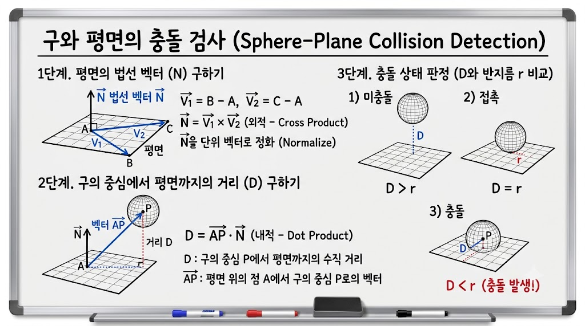
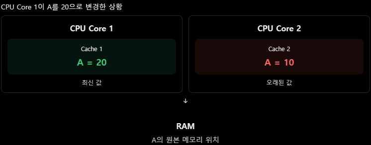
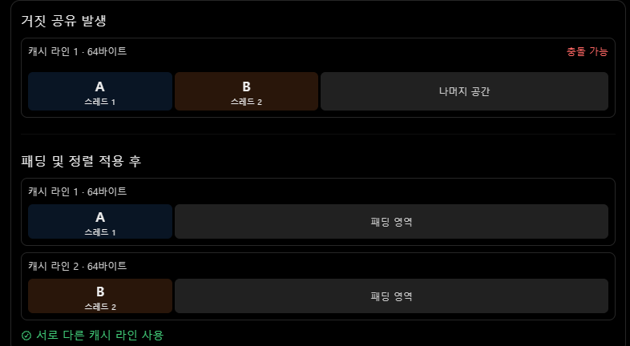

# 11/02

## 잔디 심기

[Search in Rotated Sorted Array II - NeetCode](https://neetcode.io/problems/search-in-rotated-sorted-array-ii/question)

```cpp
class Solution {
public:
    bool search(vector<int>& nums, int target) {
        int arrSize=nums.size();
        int left=0;
        int right=arrSize-1;
        int mid=0;

        while(left<=right)
        {
            mid=(left+right)/2;
            int lVal=nums[left];
            int rVal=nums[right];
            int midVal=nums[mid];
            if(lVal<midVal)
            //왼쪽 구간 정렬
            {
                if(lVal <= target && target < midVal)
                //왼쪽 구간에 만약에 
                {
                    right = mid - 1;
                }
                else
                {
                    left = mid + 1;
                }
            }
            else if(lVal==midVal)
            //중복 원소로 인해 어느 구간이 정렬되어있는지 판단하기 어려운경우
            {
                /*
                midVal!=target 이고 lVal==midVal 이므로
                nums[left]역시 target이 아니다.
                따라서 left 위치를 탐색 범위에서 제외하고 다음 단계로 탐색
                */
                left++;
            }
            else
            //오른쪽 구간이 정렬
            {
                if(rVal>=target&&target>midVal)
                //타겟이 오른쪽 구간에 있으면 왼쪽 구간 버림
                {
                    left=mid+1;
                }
                else
                //왼쪽이면 오른쪽 구간 버림
                {
                    right=mid-1;
                }
            }
            if(midVal==target)
            {
                return true;
            }
        }
        return false;
    }
};
```

## 자소서 작성

## VR 플젝 코드 분류

## 과거 면접 스터디 cs 정리

### 업캐스팅 vs 다운캐스팅

> 상속 관계에 있는 클래스 사이에서 타입을 변환하는 것

- 업캐스팅 : 자식 클래스 → 부모 클래스
- 다운캐스팅 : 부모 클래스 → 자식 클래스

---

## `업캐스팅`

> 자식 클래스의 포인터나 참조를 부모 클래스 타입으로 변환하는 것

`⇒ 기본클래스 포인터로 파생클래스 객체를 가리키는 것`

#### 특징

- 일반적인 public 상속에서는 명시적 형변환 없이 가능
- 부모 클래스에 정의된 멤버에 접근할 수 있음
- 실제 객체가 자식 객체라는 사실은 변하지 X

#### 장점

- 여러 자식 객체를 부모 타입으로 통합 관리
- 공통 기능을 하나의 코드로 처리
- 새로운 자식 클래스 추가 시 기존 관리 코드 재사용
- 구체적인 자식 클래스에 대한 의존성 감소

⇒ 서로 다른 객체를 동일한 **런타임 인터페이스로** 다룰 수 있음이 장점!

#### 사용이유

> 여러 자식을 하나의 부모 타입으로 통일해서 다루기 위해  
> ⇒ 종류가 다른 객체를 같은 방식으로 다루면 새 종류가 추가돼도 기존 코드를 고칠 필요가 없다.

#### 예시) 몬스터

```cpp
class Monster
{
public:
    virtual void Attack()
    {
        cout << "기본 공격" << '\n';
    }
    virtual ~Monster() = default;
};
class Slime : public Monster
{
public:
    void Attack() override
    {
        cout << "몸통 박치기" << '\n';
    }
};
class Goblin : public Monster
{
public:
    void Attack() override
    {
        cout << "칼 공격" << '\n';
    }
};
```

#### 업캐스팅을 사용하지 않는다면?

```cpp
int main()
{
    Slime slime1;
    Slime slime2;
    Goblin goblin1;
    Goblin goblin2;

    Slime* slimes[2] = { &slime1, &slime2 };
    Goblin* goblins[2] = { &goblin1, &goblin2 };
    // 슬라임 공격
    for (int i = 0; i < 2; i++)
    {
        slimes[i]->Attack();
    }
    // 고블린 공격
    for (int i = 0; i < 2; i++)
    {
        goblins[i]->Attack();
    }
}
```

문제점

- 몬스터 종류마다 배열을 별도로 만들어야함

- 몬스터 종류마다 공격 처리 코드를 작성해야함

- 새로운 몬스터가 추가되면 이를 처리하는 코드가 추가될 수 있음
  ⇒ 추가적으로 새로운 몬스터 종류에 대한 반복문이 추가 될 수 있다

#### 업캐스팅 사용하면?

```cpp
int main()
{
    Slime slime1;
    Slime slime2;
    Goblin goblin1;
    Goblin goblin2;

    Monster* monsters[4] = {&slime1, &slime2, &goblin1, &goblin2};

    for (int i = 0; i < 4; i++)
    {
        monsters[i]->Attack();
    }
}
```

`Monster*` 는 부모 타입이지만 `Attack()` 이 가상 함수이므로 실제 객체에 맞는 함수가 실행됨

⇒ 모든 몬스터를 하나의 부모 타입으로 관리하면서 실제 객체에 따른 서로 다른 동작을 수행할 수 있음

---

## `다운캐스팅`

> 부모 클래스의 포인터나 참조를 자식 클래스 타입으로 변화하는 것

#### 특징

- 안전하지 않을 수 있어서 명시적 형변환이 필요함.
- 자식 클래스에만 존재하는 멤버에 접근할 수 있음
- 실제 객체가 해당 자식 타입인지 확인해야 함

#### 사용이유

> 부모 타입으로 관리하던 객체에서 자식 클래스에만 존재하는 고유 기능을 사용하기 위함

#### 문제 상황

1. 다운캐스팅을 사용하지 않는 경우

```cpp
int main()
{
    Slime slime;

    Slime* slimePtr = &slime;

    slimePtr->Attack();
    slimePtr->Split();
}
```

⇒ 처음부터 `Slime*` 로 관리한다면 `Split()` 을 바로 호출할 수 있음

```cpp
int main()
{
    Slime slime;

    Monster* monster = &slime;

    monster->Attack(); // 가능

    // monster->Split(); // 컴파일 오류
}
```

⇒ 그러나 업캐스팅해서 `Monster*` 로 관리하면 상황이 달라짐

> 실제 객체는 `Slime`이지만, `monster`의 타입이 `Monster*`이기 때문  
> ⇒ 컴파일러는 `Monster`에 정의된 멤버를 기준으로 접근 가능 여부를 판단하므로 `Slime`에만 있는 `Split()`을 호출할 수 없음

1. 다운캐스팅을 사용하는 경우

```cpp
int main()
{
    Slime slime;

    Monster* monster = &slime; // 업캐스팅

    Slime* slimePtr = dynamic_cast<Slime*>(monster);

    if (slimePtr != nullptr)
    {
        slimePtr->Split(); // 슬라임 분열
    }
}
```

> `Monster*`를 `Slime*`로 다운캐스팅하면 `Split()`에 접근할 수 있어.

```cpp
int main()
{
    Slime slime;
    Goblin goblin;

    Monster* monsters[2] = { &slime, &goblin };

    for (int i = 0; i < 2; i++)
    {
        Slime* slimePtr = dynamic_cast<Slime*>(monsters[i]);

        if (slimePtr != nullptr)
        {
            slimePtr->Split();
        }
    }
}
```

> 여러 몬스터를 `Monster*`로 관리하고 있는데, 그중 슬라임에게만 분열 기능을 실행해야 한다고 가정해 보자.  
> ⇒ 다운 캐스팅을 사용하면 부모 타입으로 여러 몬스터를 관리하면서도, 필요한 경우 특정 자식 타입의 고유 기능에 접근이 가능하다!

---

### 업캐스팅과 가상 소멸자의 관계

#### 업캐스팅한 부모 클래스 포인터를 통해 자식 객체를 삭제할 때!!

#### 업캐스팅과 가상 소멸자의 관계

#### `가상 소멸자를 사용하지 않는 경우`

```cpp
class Monster
{
public:
 ~Monster()// virtual이 없다
    {
        cout << "Monster 소멸" << '\n';
    }
};
class Slime : public Monster
{
public:
    ~Slime()
    {
        cout << "Slime 소멸" << '\n';
    }
};
int main()
{
    Monster* monster = new Slime(); // 업캐스팅
    delete monster; // 정적 타입(Monster)만 보고 ~Monster()만 호출
    // ~Slime()은 호출되지 않아 "Slime 소멸" 이 부분이 실행 안될 수 있다
    //(표준상 정의되지 않은 동작)
}
```

문제점

> `monster`는 `Monster*` 이지만 실제로 생성된 객체는 `Slime`임.  
> 부모 소멸자가 `virtual`이 아닌 상태에서 부모 포인터로 자식 객체를 `delete`하면 정의되지 않은 동작이 발생한다.  
> 이때 **자식 소멸자가 호출되지 않아** 자원 해제가 누락될 수 있다.

#### `가상 소멸자를 사용`

```cpp
class Monster
{
public:
    virtual ~Monster() // => virtual
    {
        cout << "Monster 소멸" << '\n';
    }
};

class Slime : public Monster
{
public:
    ~Slime() override // => override
    {
        cout << "Slime 소멸" << '\n';
    }
};

int main()
{
    Monster* monster = new Slime(); // 업캐스팅
    delete monster;
}
```

> delete시 먼저 자식 소멸자를 실행하고 그다음에 부모 소멸자를 실행  
> 자식 ⇒ 부모 소멸자 순으로 실행됨

---

### 3D 공간에서 구와 평면의 충돌 판정



#### D : 바닥에서 공 중심까지의 수직 거리

#### r : 구의 반지름

### 1. 외적으로 평면의 90도 수직 벡터 세우기

### 2. 내적으로 공 중심까지의 수직 거리 (D) 구하기

### 3. D와 반지름 r을 비교

- D > r (미충돌)
- D = r (접촉)
- D < r (충돌, 관통)

---

### 캐시 일관성 + MESI 프로토콜

#### 캐시 일관성

> 여러 CPU 코어가 각각의 캐시에 동일한 메모리 데이터를 저장하고 있을 때 데이터가 변경되더라도 서로 일관된 값을 사용할 수 있도록 유지하는 것

⇒ 현대 CPU는 연산 속도를 높이기 위해 코어마다 독립된 L1 / L2 캐시를 탑재하고 있음. 메인 매모리의 동일한 변수를 여러 코어가 읽어서 캐싱하고 있을 때 문제 발생

#### 필요이유

> 멀티코어 CPU에서는 각 코어가 자신 만의 캐시를 가지고 있음

EX) 램에 A=10 이 저장되어 있다고 가정



⇒ 위 상황에서 코어 2가 이전 값인 10을 계속 사용한다면 문제 발생

### 캐시 일관성을 유지하는 방법 ⇒ MESI 프로토콜

⇒ MESI는 캐시 라인을 다음 4가지 상태로 관리함

#### M (Modified)

> 해당 데이터는 오직 이 캐시에만 존재하며, **메인 메모리의 데이터와 다름**

#### E (Exclusive)

> 해당 데이터는 오직 이 캐시에만 존재하며, **메인 메모리의 데이터와 동일**

#### S (Shared)

> 해당 데이터는 여러 캐시에 **복제되어 존재**하며, 모두 메인 메모리의 데이터와 **동일**

#### I (Invalid)

> 해당 데이터는 유효하지 않음

### 동작 흐름

1. 읽기 시 : 코어 A와 B가 HP를 읽으면 둘 다 캐시 라인 상태가 `S (Shared)`가 됨
2. 쓰기 시 : 코어 A가 HP를 70으로 바꾸려 할 때 버스를 통해 다른 코어들에게 “나 이 캐시 라인 쓴다”라는 무효화 신호를 브로드캐스팅함
3. 무효화 : 신호를 들은 코어 B는 자신의 캐시 라인을 즉시 `I (Invalid)` 상태로 바꿈. 이제 코어 A의 캐시 라인은 `M (Modified)` 이됩니다.
4. 재접근 : 이후 코어 B가 다시 HP를 읽으려 한다면 자신의 캐시 라인이 `I (Invalid)` 상태이므로 캐시 미스가 발생하고 코어 A가 수정한 최신 값 (70)을 버스를 통해 새로 받아와 상태를 다시 동기화합니다.

---

### 캐시 일관성과 동기화는 다름!

> 캐시 일관성이 유지된다고 해서 멀티스레드 프로그램의 모든 동시성 문제가 해결되는 것은 아님!  
> 여러 스레드가 동일한 변수를 동시에 수정하면 여전히 데이터 레이스가 발생할 수 있음. 따라서 뮤텍스와 같은 기법을 사용해서 동기화가 필요하다.

---

### false sharing (거짓 공유)

#### 정의

CPU 캐시는 캐시라인 단위 (보통 64바이트)로 메모리를 읽음

서로 다른 스레드가 다른 변수를 쓰는데, 그 변수들이 같은 캐시라인에 올라가 있으면 불필요한 캐시 무효화가 발생함. ⇒ 이것이 거짓 공유

#### EX) 스레드 1은 변수 A만 수정하고 스레드 2 는 변수 B만 수정한다고 가정

⇒ 논리적으로는 두 스레드는 서로 다른 변수를 건드리므로 LOCK이 필요 없어 보임.

A와 B가 메모리상에 나란히 붙어 있어 같은 64바이트 캐시 라인안에 묶여 있다면 코어 1이 A를 코칠 때마다 코어 2의 캐시 라인 전체가 Invalid로 날아가고 반대로 코어 2가 B를 고칠 때도 코어 1의 캐시 라인이 날아갑니다.

결과 적으로 코어들이 서로의 캐시를 끝없이 지우고, 다시 메모리에서 땡겨오는 캐시 핑퐁이 발생하여 멀티스레드로 설계 했는데 싱글스레드보다 더 느려지는 참사가 일어남

---

### False Sharing 해결법

#### 패딩(Padding)과 메모리 정렬(Alignment)

> 서로 다른 스레드가 사용하는 변수를 별도의 캐시 라인에 배치하여 캐시 무효화 충돌을 줄이는 방법

EX) 캐시 라인 크기가 64바이트라고 가정



```cpp
#include <atomic>

struct Counter
{
    std::atomic<int> value{0};
};

Counter counters[2];
```

⇒ 두 `Counter` 객체가 같은 캐시 라인에 배치되면 서로 다른 스레드가 `counters[0,1]`을 수정할 때 거짓 공유 발생 가능!

#### 해결 방법

```cpp
#include <atomic>

struct alignas(64) Counter
{
    std::atomic<int> value{0};
};

Counter counters[2];
```

- `alignas(64)`는 객체를 64바이트 경계에 정렬하도록 지정.
- 이 구조체의 크기도 최소 64바이트가 되므로 배열의 두 원소가 서로 다른 64바이트 캐시 라인에 배치
- 따라서 캐시 라인 공유로 인한 성능 저하를 방지할 수 있음
