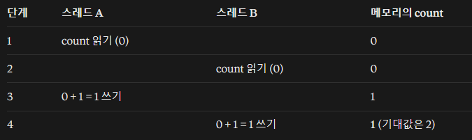
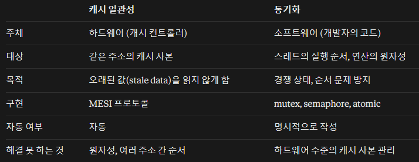

# 11/05

## 면접 스터디 회고 및 CS 정리

### 캐시 일관성 vs 동기화

#### 캐시 일관성 ⇒ 하드웨어

> **하드웨어**가 코어별 캐시의 같은 주소 값을 맞춰주는 것.

⇒ 멀티코어에서 코어마다 캐시가 있을 때 같은 메모리 주소의 사본들이 서로 다른 값을 갖지 않도록 하드웨어가 자동으로 유지하는 것

- 개발자가 신경 스지 않아도 항상 동작함

#### 동기화 ⇒ 소프트웨어

> **소프트웨어**가 스레드의 접근 순서와 원자성을 제어하는 것

⇒ 여러 스레드가 공유 자원에 접근할 때 실행 순서와 원자성을 제어해서 경쟁 상태를 막는 것

- 개발자가 명시적으로 코드에 넣어야 함

#### 일관성이 있는데도 동기화가 필요한가?

> `count++` 한 줄은 CPU에서 **읽기 → 더하기 → 쓰기** 세 단계라서, 캐시가 완벽히 일관돼도 두 스레드가 끼어들면 값이 유실

⇒ 캐시 일관성은 모든 코어가 같은 값 (1) 을 보게 해줄 뿐 2번 단계에서 B가 읽은 값이 이미 낡았다는 문제는 막지 못함.  
읽고 계산하고 쓰는 묶음을 원자적으로 만드는 것이 동기화의 역할

